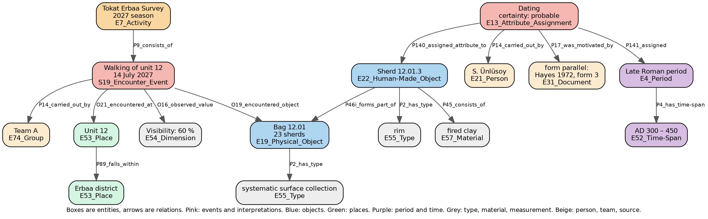

# Making Fieldwork Data FAIR at the Source: A CIDOC CRM Conformant Recording Model That Needs No Data Modeller

**Summary of a doctoral thesis proposal, prepared for the Tokat Erbaa Survey**

Author: Tuğçe Köseoğlu, doctoral candidate
Thesis adviser: Prof. Dr. Çiler Çilingiroğlu, Department of Archaeology, Ege University
Computer engineering side: Prof. Dr. Murat Osman Ünalır, Department of Computer Engineering, Ege University
Prepared for: Assoc. Prof. Dr. Sinan Ünlüsoy, Yaşar University
Date: 20 October 2026

This is the summary of the thesis proposal prepared for survey directors and for colleagues abroad. A Turkish version of the same text is provided separately.

## 1. The problem

In Türkiye, the record produced by an excavation or a field survey cannot be used by anyone outside the team that made it. It lives on paper forms, in Excel sheets, in Word files and on the Ministry's inventory forms, and every team uses its own layout and its own terms. What leaves the project is the distilled report in the annual symposium volumes. The record cannot be found by another researcher, cannot be accessed, cannot be joined to another record, and cannot be reused by anyone but its makers. None of the four FAIR principles, the international benchmark for research data, is met.

Among the reasons given for this, some are technical: there is no standard, no tool, nobody on the team to do it, no time. That reason has never been tested. The international standard, CIDOC CRM with its archaeological extensions, has existed for years, and open-source tools built on it exist. No excavation or survey in Türkiye uses them. The cause is that those tools need a data modeller, a server, English, and term lists that do not exist for Turkish fieldwork.

## 2. The research question

Can a Turkish field team record directly into a CIDOC CRM conformant, FAIR structure without a data modeller; what share of what they record becomes comparable data at the point of recording; and how FAIR is the resulting record?

Three sub-questions, each with its evidence:

| Sub-question | Evidence |
|---|---|
| How is the structure derived from the standard, and can the derivation be repeated | A written procedure and a decision log that holds every choice with its reason |
| Where do the words come from | Turkish term lists compiled from the teams' own records and speech, aligned to international vocabularies where possible |
| What does it cost the team, and what does the reader gain | The share of recorded information held in comparable form at the moment of recording; an assessment of the output against FAIR criteria; whether an archaeologist who was not there can answer questions from the record |

A second claim is argued in the discussion rather than measured: once the technical barrier is lowered to this level, whatever still stands in the way of data sharing becomes visible. The literature says the technical barrier is rarely the main one. That too would be a finding.

## 3. Two concepts, briefly

**CIDOC CRM** is the conceptual model for cultural heritage information developed by ICOM's documentation committee and published as ISO 21127. It is neither software nor a database. It is a shared grammar: who, what, where, when, in which event. A spreadsheet row says "lamp, unit 12, Roman". CIDOC CRM states the same thing as an object, the observation event in which it was encountered, a place, and a dating that a named person made on stated grounds. Keeping interpretation apart from observation, with the author and the grounds recorded, is the model's main value for archaeology. Its archaeological extensions cover excavation and stratigraphy, observation and sampling, location, and argumentation. ARIADNE, the European archaeological data infrastructure, is built on it.

Figure 1 shows what one survey unit looks like in this model. The example is invented; the classes are real. The survey season is an activity and the walking of the unit is part of it. The walking event takes place at a place, is carried out by a team, observes a visibility value, and encounters a bag of finds. The diagnostic sherd in the bag is an object whose type and material come from lists. The dating is not a property of the sherd but a separate event: who made it, on what grounds, how certain, to which period. The period itself is not a name but a definition with its years. What sits in a single spreadsheet cell as "Late Roman" opens here into four boxes and four arrows, and what looks like excess is exactly what keeps the record of an interpretation apart from an observation.

The model has two limits. It cannot be used directly; it needs expertise. And it does not supply the words: it says a find has a type, not which list the type comes from. No such list exists for Turkish fieldwork terms.

**FAIR** stands for four principles: research data should be findable, accessible, interoperable and reusable. It is not the same as open data. A dataset can be closed and still be FAIR, as long as its existence is known and the conditions of access are written down. The director's right of publication, the Ministry's ownership of the material, and the protection of findspots do not conflict with this. Coordinates can stay closed while the rest of the record is FAIR. "As open as possible, as closed as necessary" is the thesis's default position.

## 4. Method

**The structure is derived from the standard.** The user fills in a form. Each field's counterpart in the standard is fixed once, in advance, and the conformant output is generated. What the standard does not decide, such as which fields are required, whether a bag of sherds is one record or twenty, and which list is attached to which field, is a human decision, and each one is logged with its reason. The structure is modular: a core, then survey, excavation and stratigraphy, sampling and analysis, interpretation and argument, location, and documentation. An unused module stays empty.

**The words come from field practice.** The lists are compiled from the terms teams actually use: every term on their forms, in their spreadsheets and in their speech in the field, together with what it refers to. The team's own term is always kept, and a team can add its own term or field without asking anyone. Such additions stay comparable within that project only; those that spread are later promoted to the shared list.

**The recording tool.** It works offline, on a phone or a laptop. The user picks from lists; free text is confined to a remarks field. A card view serves single finds and a grid serves bulk finds. Setup needs no modeller, because the structure and the lists come ready. The Ministry's inventory forms are generated from the record. The tool is not the thesis's claim but its instrument. A spreadsheet with lists is enough for the first stage.

**Three archaeological decisions.** Observation and interpretation are separate fields, and every interpretation carries who, on what grounds, and how certain. A period is a definition, not a name: who defined it, for which region, which years. Absence is a record: a unit that was walked and yielded nothing is kept apart from a unit never walked.

## 5. Research design

The thesis runs on the data of two field surveys. The Ministry's inventory form is a single form for survey and excavation alike, which is why the scope is defined as fieldwork data rather than excavation data.

**First case: a completed survey.** With my adviser's permission, the records of the Karaburun survey will be used. Because the survey is finished, these records are the first source of the Turkish lists and the test of how well the structure fits a completed dataset. Since that team knows the work, this stage develops the method; it is not an independent test.

**Second case: a new survey.** An independent test needs a new survey run by a different director. The Tokat Erbaa Survey is proposed for this. Here the record is kept at the moment of recording, with the structure and the lists. This is where the claim "without a modeller" is tested.

**What is measured.** The share of information kept in comparable form, for the completed and the live record separately. An assessment of the output against published FAIR criteria. A handover test: an archaeologist who was not present tries to answer a fixed list of questions from the record alone. And the two directors' decisions, at the end, on whether and under what conditions to share the structured data.

**The excavation module.** It exists in the structure and was derived by the same procedure, but with no excavation record in hand it appears in the thesis as a designed part, not a tested claim.

## 6. What is asked of the Tokat Erbaa Survey, and what is not

**Asked.**

1. The director's written permission to use the records in the thesis, with a line on what may be published. Coordinates and findspots stay closed unless the director says otherwise.
2. In the first season, observation only: seeing how the team records now, a copy of the forms and spreadsheets in use, and notes on what is said in the field but never written down. The team's way of working is not interfered with. If possible, I take part in the fieldwork myself.
3. In the second season, or in part of the first if the team wishes, recording with the structure and the lists. This can run alongside the team's current forms. Nobody writes anything twice: the record is kept once and both formats are generated from it.
4. At the end of the season, a short evaluation with a team member on using the record, and the director's decision on sharing the structured data.

**Not asked.** No server, no installation, no technical staff, no English, no new field protocol, and no learning of a standard. The team's own terms are not changed; their counterparts are added beside them where they exist.

**What the team gets.** A copy of its own data with persistent identifiers, documentation, standard conformance and FAIR status; its own forms and the Ministry forms generated from the record; continued ownership of the data, with nothing leaving without the director's approval. During the study the data is held only on the researcher's own computer and is sent to no external service.

## 7. A pilot, and what it taught

Before arriving at this design I tried moving published excavation reports into a standard-conformant structure and measuring the loss. That pilot is not part of the thesis. It taught three things: the structure can be derived from the standard by a written procedure; most of the loss comes from the words, not the structure; and moving free text into a structure afterwards loses far more than recording from lists at the source. The third is why recording at the source is the right order.

## 8. Left out of the thesis

Large language models are not in the core of the thesis. When the record is kept by picking from lists, no model is needed. Their place is the later transfer of existing archives into the structure, which is the step after the thesis and the subject of a planned TÜBİTAK project. Testing the excavation module waits until an excavation record is available.

## 9. Timeline

| Period | Work |
|---|---|
| End of 2026 | Written procedure and decision log; receipt of the Karaburun records |
| First half of 2027 | Lists compiled from Karaburun; fit test on the completed record; spreadsheet with lists |
| 2027 field season | Tokat Erbaa: observation season; forms and terms collected |
| End of 2027 | Recording tool; lists extended with Tokat Erbaa terms |
| 2028 field season | Tokat Erbaa: recording with the structure |
| End of 2028 | FAIR assessment, handover test, writing |

The timeline will be adapted to the survey's own season plan.
