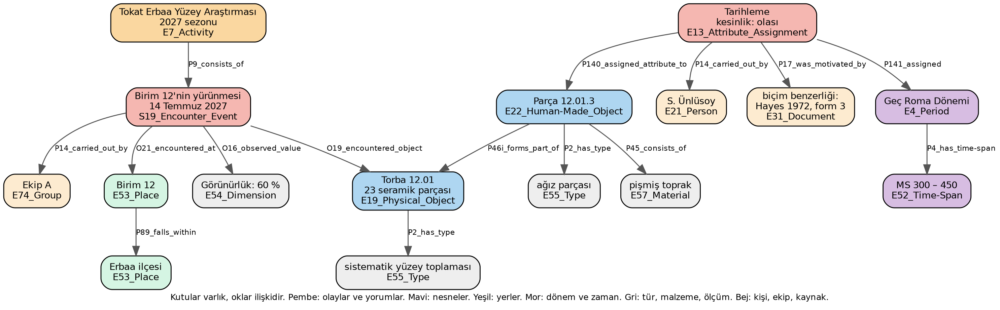

# Arazi Verisini Kaynağında FAIR Kılmak: CIDOC CRM ile Uyumlu, Veri Modelcisi Gerektirmeyen Bir Kayıt Modeli

**Doktora tez önerisi özeti — Tokat Erbaa Yüzey Araştırması için hazırlanmıştır**

Hazırlayan: Tuğçe Köseoğlu, doktora öğrencisi
Tez danışmanı: Prof. Dr. Çiler Çilingiroğlu, Ege Üniversitesi, Arkeoloji Bölümü
Bilgisayar mühendisliği tarafı: Prof. Dr. Murat Osman Ünalır, Ege Üniversitesi, Bilgisayar Mühendisliği Bölümü
Sunulan: Doç. Dr. Sinan Ünlüsoy, Yaşar Üniversitesi
Tarih: 20 Ekim 2026

Bu belge, tez önerisinin araştırma başkanları ve yurt dışındaki meslektaşlarla paylaşılmak üzere hazırlanmış özetidir. Aynı metnin İngilizcesi ayrıca verilmiştir.

## 1. Sorun

Türkiye'de bir kazının ya da yüzey araştırmasının ürettiği kayıt, onu üreten ekibin dışında kullanılamaz durumdadır. Kayıt kâğıt formlarda, Excel tablolarında, Word belgelerinde ve Bakanlığın envanter formlarında tutulur; her ekip kendi düzenini ve kendi terimlerini kullanır. Dışarıya yalnızca Kazı Sonuçları ve Araştırma Sonuçları Toplantıları'ndaki damıtılmış rapor çıkar. Kayıt, başka bir araştırmacı tarafından bulunamaz, ona erişilemez, başka bir kayıtla birleştirilemez ve onu üretenler dışında biri tarafından yeniden kullanılamaz. Araştırma verisi için uluslararası ölçüt olan FAIR ilkelerinin dördü de karşılanmamaktadır.

Bu durumun gerekçeleri arasında teknik olanlar vardır: standart yoktur, araç yoktur, ekipte bu işi yapacak kimse yoktur, zaman yoktur. Bu gerekçe hiç sınanmamıştır. Uluslararası standart, yani CIDOC CRM ve arkeoloji ekleri, yıllardır mevcuttur; üzerine kurulmuş açık kaynaklı araçlar da vardır. Türkiye'de hiçbir kazı ya da araştırma bunları kullanmamaktadır. Nedeni, bu araçların bir veri modelcisi, bir sunucu, İngilizce ve Türkiye'de var olmayan terim listeleri gerektirmesidir.

## 2. Tezin sorusu

Bir Türk arazi ekibi, veri modelcisi olmadan, doğrudan CIDOC CRM ile uyumlu ve FAIR bir yapıya kayıt tutabilir mi; kaydettiklerinin ne kadarı kayıt anında karşılaştırılabilir veriye dönüşür; ortaya çıkan kayıt hangi düzeyde FAIR'dir?

Üç alt soru ve her birinin kanıtı:

| Alt soru | Kanıt |
|---|---|
| Yapı standarttan nasıl türetilir ve bu türetme tekrarlanabilir mi | Yazılı bir yöntem ve her kararın gerekçesiyle tutulduğu bir karar günlüğü |
| Sözcükler nereden gelir | Arazi ekiplerinin kendi kayıtlarından ve dilinden derlenen, mümkün olduğunda uluslararası sözlüklerle eşlenen Türkçe listeler |
| Ekibe maliyeti, okuyucuya getirisi nedir | Kayıt anında karşılaştırılabilir biçimde saklanan bilginin oranı; çıktının FAIR ölçütleriyle değerlendirilmesi; çalışmada bulunmamış bir arkeoloğun kayıttan soruları yanıtlayabilmesi |

Tartışma bölümünde savunulacak ikinci bir sav vardır: teknik engel bu düzeye indiğinde, veri paylaşımının önünde ne kaldığı daha açık görülür. Literatür, teknik engelin çoğu zaman asıl engel olmadığını söylemektedir; bu da bir bulgu olur.

## 3. İki kavram, kısaca

**CIDOC CRM**, kültürel miras bilgisi için ICOM'un geliştirdiği ve ISO standardı olan (ISO 21127) bir kavram modelidir. Yazılım ya da veritabanı değil, ortak bir dilbilgisidir: kim, neyi, nerede, ne zaman, hangi olayda. Bir Excel satırında "kandil, 12 numaralı birim, Roma Dönemi" yazar; CIDOC CRM aynı bilgiyi bir nesne, onun bulunduğu bir gözlem olayı, bir yer ve bir kişinin belirli bir gerekçeyle yaptığı tarihleme yorumu olarak ifade eder. Yorumun gözlemden ayrı tutulması, kimin yaptığının ve neye dayandığının kayıtlı olması, modelin arkeoloji için asıl değeridir. Arkeolojiye özgü ekleri kazıyı ve tabakalanmayı, gözlemi ve örnek almayı, konumu ve yorumu kapsar. Avrupa'daki arkeolojik veri altyapısı ARIADNE bu model üzerine kuruludur.

Şekil 1, bir yüzey araştırması biriminin bu modelde nasıl göründüğünü gösterir. Örnek uydurmadır; sınıflar gerçektir. Araştırma sezonu bir etkinliktir ve birimin yürünmesi onun bir parçasıdır. Yürüme olayı bir yerde gerçekleşir, bir ekip tarafından yapılır, bir görünürlük değeri gözlemler ve bir torba buluntuyla karşılaşır. Torbanın içindeki tanımlayıcı parça bir nesnedir; türü ve malzemesi listeden gelir. Tarihleme ise parçanın bir özelliği değil, ayrı bir olaydır: kim yaptı, neye dayanarak, ne kadar kesin, hangi döneme. Dönemin kendisi de bir ad değil, yıllarıyla birlikte bir tanımdır. Bir Excel satırında tek hücrede duran "Geç Roma" bu şekilde dört kutuya ve dört oka açılır; fazlalık gibi görünen şey, yorumun kaydını gözlemden ayıran şeydir.

Modelin iki sınırı vardır. Doğrudan kullanılamaz; uzmanlık ister. Ve sözcükleri vermez: bir buluntunun bir türü olduğunu söyler, türün hangi listeden geldiğini söylemez. Türkçe arazi terimleri için böyle bir liste yoktur.

**FAIR**, araştırma verisinin bulunabilir, erişilebilir, birlikte çalışabilir ve yeniden kullanılabilir olmasını isteyen dört ilkedir. Açık veri ile aynı şey değildir. Bir veri seti erişime kapalı olabilir ve yine de FAIR olabilir; yeter ki var olduğu bilinsin ve erişim koşulu yazılı olsun. Araştırma başkanının yayın hakkı, Bakanlığın malzeme üzerindeki mülkiyeti ve buluntu yerlerinin korunması bununla çelişmez. Koordinatlar kapalı kalabilir; kaydın geri kalanı yine FAIR olabilir. "Olabildiğince açık, gerektiği kadar kapalı" tezin varsayılan tutumudur.

## 4. Yöntem

**Yapı standarttan türetilir.** Kullanıcı bir form doldurur; her alanın standarttaki karşılığı önceden ve bir kez belirlenmiştir; standarda uygun çıktı kendiliğinden üretilir. Standardın belirlemediği şeyler, yani hangi alanların zorunlu olduğu, bir torba seramiğin tek kayıt mı yirmi kayıt mı olduğu, hangi listenin hangi alana bağlandığı, insan kararıdır ve her biri gerekçesiyle günlüğe yazılır. Yapı modüllerden oluşur: çekirdek, yüzey araştırması, kazı ve tabakalanma, örnek ve analiz, yorum ve gerekçe, konum ve belgeleme. Kullanılmayan modül boş kalır.

**Sözcükler arazi pratiğinden gelir.** Listeler, ekiplerin fiilen kullandığı sözcüklerden derlenir: formlarındaki, tablolarındaki ve arazide söyledikleri her terim, neye işaret ettiğiyle birlikte. Ekibin kendi terimi daima korunur; ekip kimseden izin almadan kendi terimini ya da alanını ekleyebilir. Böyle eklemeler yalnızca o çalışma içinde karşılaştırılabilir kalır; yaygınlaşanlar sonradan ortak listeye alınır.

**Kayıt aracı.** Çevrimdışı çalışır; telefonda ya da dizüstü bilgisayarda çalışır; kullanıcı listeden seçer, serbest metin yalnızca açıklama alanındadır; tekil buluntu için kart, toplu buluntu için tablo görünümü vardır; kurulumu modelci gerektirmez; Bakanlığın envanter formlarını kayıttan kendiliğinden üretir. Araç tezin savı değil, ölçüm aletidir. İlk aşamada listeli bir elektronik tablo yeterlidir.

**Üç arkeolojik karar.** Gözlem ile yorum ayrı alanlarda tutulur ve her yorum kim, neye dayanarak, ne kadar kesinlikle bilgisiyle saklanır. Dönem bir ad değil bir tanımdır: kim tanımladı, hangi bölge için, hangi yıllar. Yokluk da bir kayıttır: yürünmüş ve hiçbir şey bulunmamış bir birim ile hiç yürünmemiş bir birim ayrı tutulur.

## 5. Araştırma tasarımı

Tez iki yüzey araştırmasının verisiyle yürütülecektir. Bakanlığın envanter formu yüzey araştırması ile kazı için tek formdur; bu nedenle tezin kapsamı "arazi verisi" olarak tanımlanmıştır.

**Birinci çalışma: tamamlanmış bir araştırma.** Danışmanımın onayıyla Karaburun yüzey araştırmasının kayıtları kullanılacaktır. Çalışma bitmiş olduğu için bu kayıtlar Türkçe listelerin ilk kaynağıdır ve yapının tamamlanmış bir veri setine ne ölçüde uyduğunun sınamasıdır. Ekip çalışmayı tanıdığı için bu aşama yöntemi geliştirme aşamasıdır, bağımsız sınama değildir.

**İkinci çalışma: yeni bir araştırma.** Bağımsız sınama için başka bir başkanın yürüttüğü yeni bir yüzey araştırması gerekmektedir. Tokat Erbaa Yüzey Araştırması bu çalışma için düşünülmektedir. Burada kayıt, yapı ve listelerle, kayıt anında tutulacaktır. Bu çalışma "modelci olmadan" savının sınandığı yerdir.

**Ölçülenler.** Karşılaştırılabilir biçimde saklanan bilginin oranı, tamamlanmış ve canlı kayıt için ayrı ayrı. Çıktının FAIR ölçütleriyle değerlendirilmesi. Devir sınaması: çalışmada bulunmamış bir arkeolog, önceden belirlenmiş bir soru listesini yalnızca kayıttan yanıtlamaya çalışır. Ve iki başkanın, çalışma sonunda yapılandırılmış veriyi hangi koşullarla paylaşmaya karar verdikleri.

**Kazı modülü.** Yapıda vardır ve aynı yöntemle türetilmiştir; ancak kazı kaydı olmadığı için tezde sınanmış bir sav olarak değil, tasarlanmış bir parça olarak yer alacaktır.

## 6. Tokat Erbaa Yüzey Araştırması'ndan ne istenir, ne istenmez

**İstenen.**

1. Başkanın yazılı izni: kayıtların tezde kullanılması ve neyin yayımlanabileceğine dair bir satır. Koordinatlar ve buluntu yerleri, başkan aksini söylemedikçe kapalı kalır.
2. İlk sezonda yalnızca gözlem: ekibin bugün nasıl kaydettiğini görmek, kullandığı formların ve tabloların birer kopyası, ve arazide söylenip de yazılmayanların not edilmesi. Ekibin çalışma biçimine müdahale edilmez. Mümkünse araziye kendim katılırım.
3. İkinci sezonda, ya da ekip isterse ilk sezonun bir bölümünde, kaydın yapı ve listelerle tutulması. Bu, ekibin bugünkü formlarına paralel yürütülebilir; ekip hiçbir şeyi iki kez yazmak zorunda kalmaz, kayıt bir kez tutulur ve her iki biçim ondan üretilir.
4. Sezon sonunda ekipten biriyle, kaydın kullanımına dair kısa bir değerlendirme; ve başkanın, yapılandırılmış verinin paylaşımına dair kararı.

**İstenmeyen.** Sunucu, kurulum, teknik personel, İngilizce, yeni bir arazi protokolü ya da bir standardın öğrenilmesi istenmez. Ekibin kendi terimleri değiştirilmez; yanlarına, varsa, karşılıkları eklenir.

**Ekibin eline geçen.** Kendi verisinin kalıcı tanımlayıcılı, tanımlı, standarda uygun ve FAIR bir kopyası; kendi formlarının ve Bakanlık formlarının kayıttan üretilmiş hâlleri; verinin sahibi olarak kalmaları ve hiçbir şeyin başkanın onayı olmadan dışarı çıkmaması. Veri, çalışma süresince yalnızca araştırmacının kendi bilgisayarında tutulur; yurt dışındaki hiçbir hizmete gönderilmez.

## 7. Ön deneme ve öğrettikleri

Bu tasarıma gelmeden önce yayımlanmış kazı raporlarını standarda uygun bir yapıya aktarmayı ve kaybı ölçmeyi denedim. Bu deneme tezin parçası değildir. Üç şey öğretti: yapı standarttan yazılı bir yöntemle türetilebilir; kaybın büyük kısmı yapıdan değil sözcüklerden gelir; ve serbest metinden yapıya sonradan aktarmak, listeden seçerek kaynağında kaydetmekten çok daha fazla kaybettirir. Üçüncüsü, kaydı kaynağında tutmanın neden doğru sıra olduğunu gösterir.

## 8. Tezin kapsamı dışında bırakılanlar

Büyük dil modelleri tezin çekirdeğinde yoktur; kayıt listeden seçerek tutulduğunda modele gerek kalmaz. Modellerin yeri, mevcut arşivlerin sonradan yapıya aktarılmasıdır ve bu, tezden sonraki adımdır; planlanan bir TÜBİTAK projesinin konusudur. Kazı modülünün sınanması, kazı kaydı elde edilene kadar beklemektedir.

## 9. Takvim

| Dönem | İş |
|---|---|
| 2026 sonu | Yapının yazılı yöntemi ve karar günlüğü; Karaburun kayıtlarının alınması |
| 2027 ilk yarı | Karaburun'dan listelerin derlenmesi; yapının tamamlanmış kayda uyum sınaması; listeli elektronik tablo |
| 2027 arazi sezonu | Tokat Erbaa: gözlem sezonu; formların ve terimlerin derlenmesi |
| 2027 sonu | Kayıt aracı; listelerin Tokat Erbaa terimleriyle genişletilmesi |
| 2028 arazi sezonu | Tokat Erbaa: yapı ile kayıt |
| 2028 sonu | FAIR değerlendirmesi, devir sınaması, yazım |

Takvim, araştırmanın kendi sezon planına göre uyarlanacaktır.
